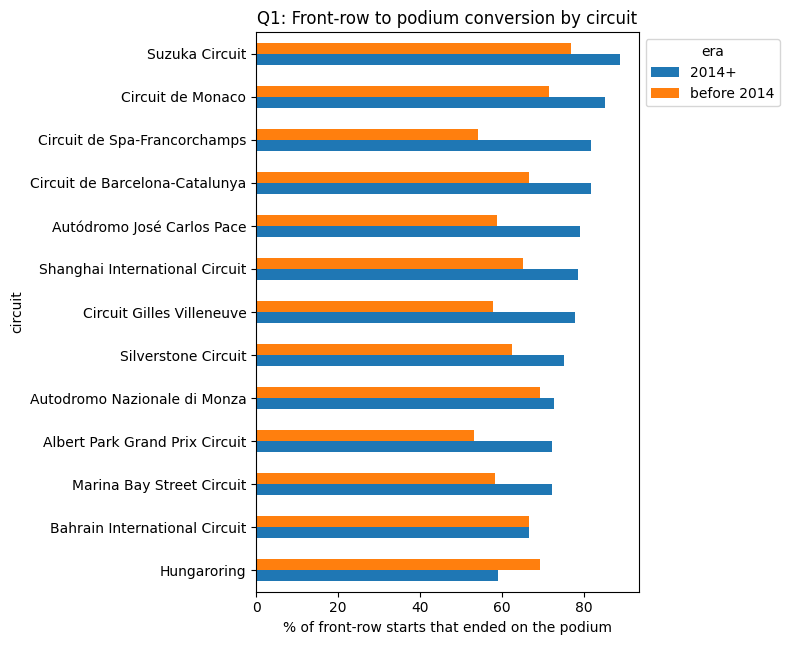
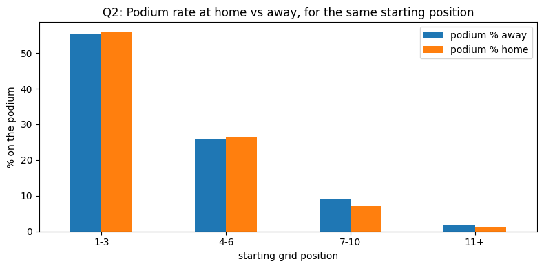
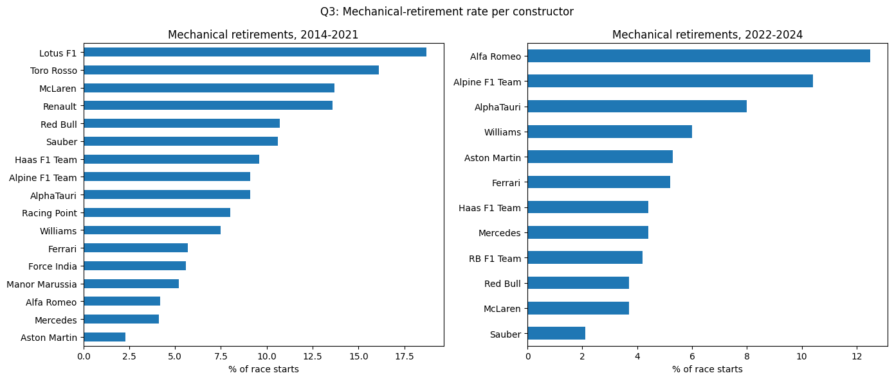
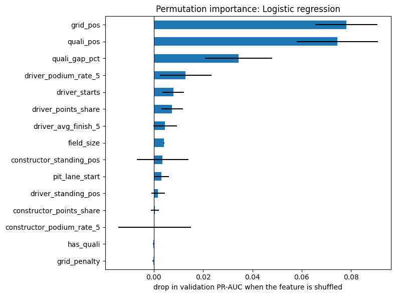
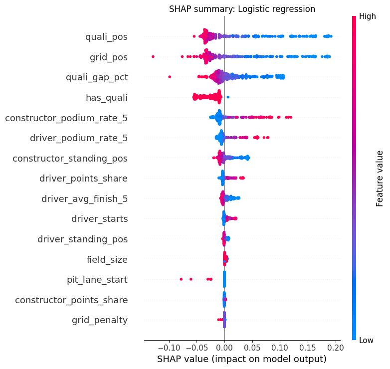
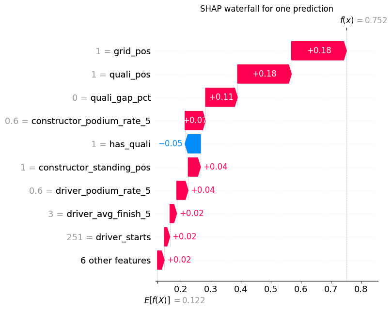
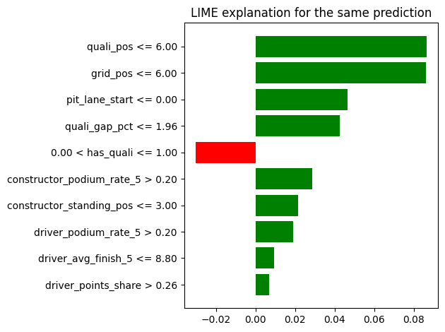

# Member 2: Data-engineering questions and explainability

## 1. Data-engineering questions

All three answers come from Section 2 of the notebook. Each one joins several tables. The grain is one row per
driver per race, the same as the cleaned `results` table. None of these results are used as model features.

### Q1: Which circuits turn a front-row start into a podium most often, and did that change after 2014?

**Method.** We join `results` → `races` → `circuits` and `results` → `qualifying`. A front-row start means starting
1st or 2nd on the grid. Conversion is the share of front-row starters who finish in the top 3. Qualifying position and
grid position are kept apart, because penalties can move a driver after qualifying: in 74 rows the two disagree about
the front row. The grid is the main definition and qualifying is a check. Only seasons with qualifying data (from
1994) are used, so both definitions use the same rows. Circuits with fewer than 12 front-row starts in an era are
left out.

**Answer.** After 2014, a front-row start became a safer bet: conversion went up at 11 of the 13 circuits. Bahrain
stayed the same and only the Hungaroring went down (-10 points). Suzuka and Monaco are the top two in both eras
(Suzuka 77 % → 89 %, Monaco 71 % → 85 %). The rest of the order changed a lot: the rank agreement between the eras is
only 0.23 (1 = same order). Spa moved up the most (54 % → 82 %). Using qualifying instead of the grid gives almost the
same picture (agreement 0.88).

**Cutoff and limits.** Grid and qualifying are both known before the race; the finishing position is only the outcome
we count. Only 13 circuits have enough starts in both eras, and each rate is based on a few dozen starts, so the
change at a single circuit can be noise.

### Q2: Do drivers podium more often at home, for the same starting position?

**Method.** We join `results` → `drivers` (nationality) and `results` → `races` → `circuits` (country). A hand-made
list maps nationality to country ("British" → "UK"); the notebook checks that every mapped country really exists.
We keep only drivers who started from a grid slot and remove the Indianapolis 500 (mostly American drivers who never
raced elsewhere). To compare drivers with similar starting positions, we split them into grid bands (1–3, 4–6, 7–10,
11+) and compare home and away inside each band.

**Answer.** No, there is no real home advantage. Ignoring the grid, home drivers podium 2.1 points *less* often.
Inside the same grid band the difference is only -0.6 points, and in every band home and away are within about
2 points of each other. Where a driver starts matters far more than where they race.

| Grid band | Podium % away | Podium % home | Difference |
|---|---|---|---|
| 1–3 | 55.4 | 55.8 | +0.5 |
| 4–6 | 26.0 | 26.5 | +0.5 |
| 7–10 | 9.2 | 7.1 | -2.1 |
| 11+ | 1.7 | 1.0 | -0.6 |

**Cutoff and limits.** Nationality, circuit and grid are known before the race. Nationality is not always "home",
drivers with two nationalities and countries without a race get no home race, and there are only about 230 home rows
in each of the front bands.

### Q3: Which constructors have the highest mechanical-retirement rate, 2014–2021 vs 2022–2024?

**Method.** We join `results` → `status`, `results` → `races` and `results` → `constructors`. The 100+ status values
are sorted with keyword lists into *finished*, *mechanical* (a part of the car failed: engine, gearbox, brakes, power
unit…) and *other retirement* (crashes, spins, disqualifications, punctures, unknown "Retired"). The notebook prints
the full mapping. The rate is mechanical retirements divided by race starts; drivers who never started are removed
and teams with fewer than 40 starts in an era are left out.

The mapping for the statuses that appear in 2014–2024 (number of race starts in brackets):

* **Mechanical:** Engine (79), Brakes (48), Gearbox (40), Power Unit (39), Suspension (25), Electrical (14),
  Hydraulics (14), Power loss (12), Wheel (11), Oil leak (10), Overheating (8), Mechanical (7), Water pressure (7),
  Turbo (6), Battery (5), Fuel pressure (5), Electronics (4), Water leak (4), ERS (4), Undertray (4), Exhaust (4),
  Wheel nut (3), Transmission (3), Rear wing (3), Radiator (3), Technical (2), Oil pressure (2), Throttle (2),
  Steering (2), Vibrations (2), Clutch (2), Drivetrain (1), Brake duct (1), Driveshaft (1), Spark plugs (1),
  Cooling system (1), Water pump (1), Fuel leak (1), Fuel pump (1), Differential (1).
* **Other retirement:** Collision (150), Accident (85), Collision damage (59), Retired (49), Disqualified (11),
  Spun off (11), Puncture (7), Tyre (4), Front wing (3), Illness (2), Damage (2), Seat (1), Excluded (1),
  Out of fuel (1), Debris (1).
* **Finished:** Finished and every "+N Lap(s)" status.

**Answer.** In 2014–2021 the highest rates were Lotus F1 (18.7 %), Toro Rosso (16.1 %) and McLaren (13.7 %), just
ahead of Renault (13.6 %). In 2022–2024 they were Alfa Romeo (12.5 %), Alpine (10.4 %) and AlphaTauri (8.0 %).
Over all teams the rate fell from 9.4 % to 5.8 % of starts, so cars became more reliable. McLaren (13.7 % → 3.7 %)
and Red Bull (10.7 % → 3.7 %) improved the most; Alfa Romeo went the other way (4.2 % → 12.5 %).

**Cutoff and limits.** Status is post-race information. That is fine here because this is a question about history,
not a model feature. Renamed teams count as separate teams (Toro Rosso → AlphaTauri → RB, Force India → Racing Point →
Aston Martin). Unknown "Retired" and tyre failures are counted as not mechanical.

## 2. Explainability (XAI)

We explain the final model chosen on validation in Section 4, **logistic regression**. Training rows are the
background, and the examples come from the validation seasons (2020–2021), so the test set is not used.

### Global explanations

**Permutation importance** shuffles one feature at a time on the validation seasons and measures how much PR-AUC
drops (10 repeats). **SHAP** splits each prediction into one contribution per feature (300 validation drivers,
100 training drivers as background).

**What they show.** Both methods agree on the top three: **grid position**, **qualifying position** and the
**qualifying gap to pole**. Shuffling the grid position costs the most PR-AUC (about 0.08), qualifying position
almost as much (about 0.07). Form and standings features add a little (about 0.01 or less each). In the SHAP plot,
low (good) grid and qualifying positions, in blue, push the prediction towards a podium.

`has_quali` is high for SHAP but zero for permutation importance. Every validation driver has qualifying data, so
shuffling it inside validation changes nothing. SHAP compares with training drivers, and most of those had no
qualifying data. This reflects the difference between old and new seasons, not a reason for podiums.

### Local explanation

The example is Lewis Hamilton at the 2020 Styrian Grand Prix (the same record as the inference demo in Section 4.9).
He started from pole. The model gave him a **75 %** podium chance against an average of 12 %, and he did finish on
the podium.

The SHAP waterfall shows that starting 1st (+0.18), qualifying 1st (+0.18) and a qualifying gap of 0 (+0.11) pushed
the chance up the most; his team's recent podiums added +0.07. LIME agrees: its two biggest reasons are also
qualifying position and grid position in the top 6.

### Not causal

These explanations show what the **model relies on**, not what **causes** a podium. Many features are linked: a fast
car gives good grid positions, good form and good standings at the same time. The model may use one of them while
the real reason is the car.

### Limits

Grid and qualifying position are almost the same thing, so the methods can split credit between them unevenly.
SHAP uses a sample of 300 drivers to stay fast, and LIME depends on random sampling (the seed is fixed).
