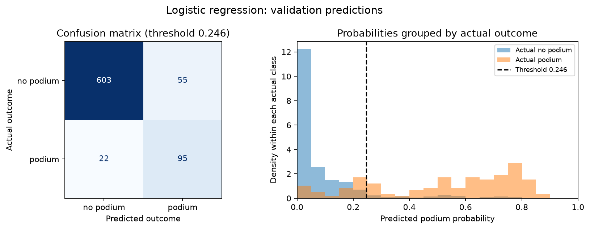
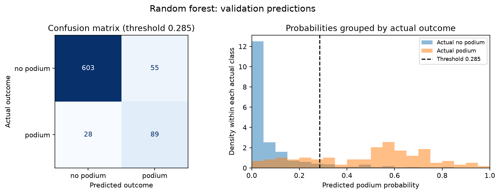
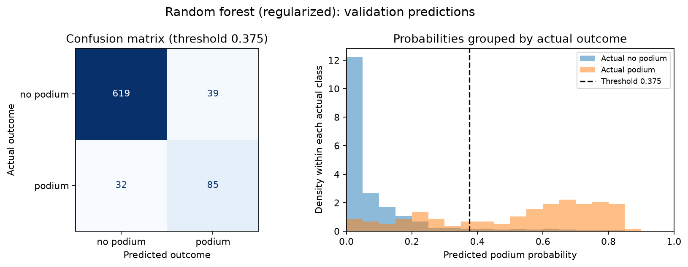
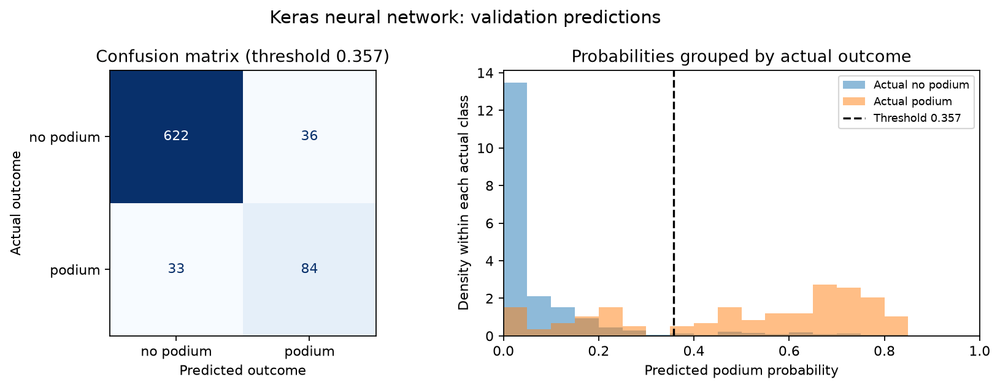
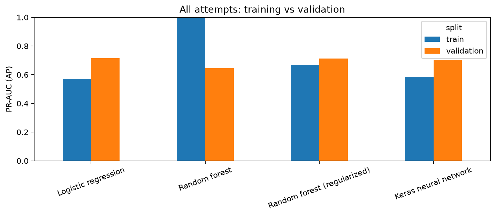
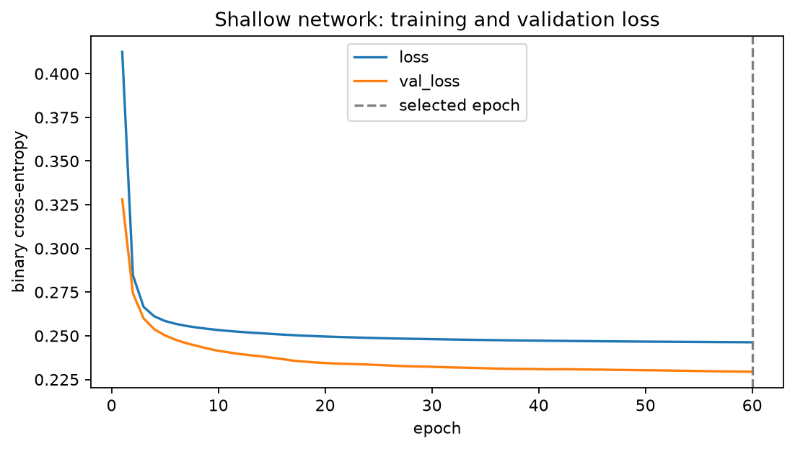
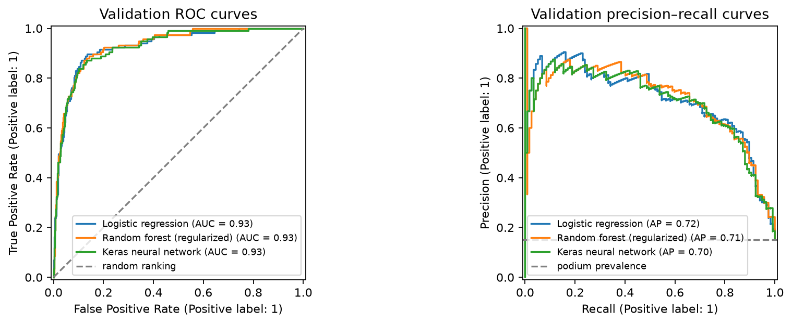
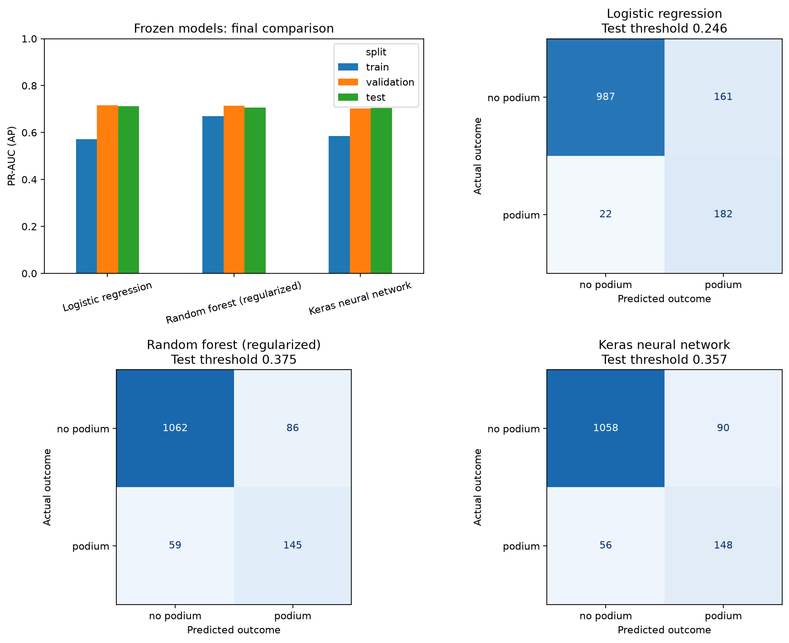
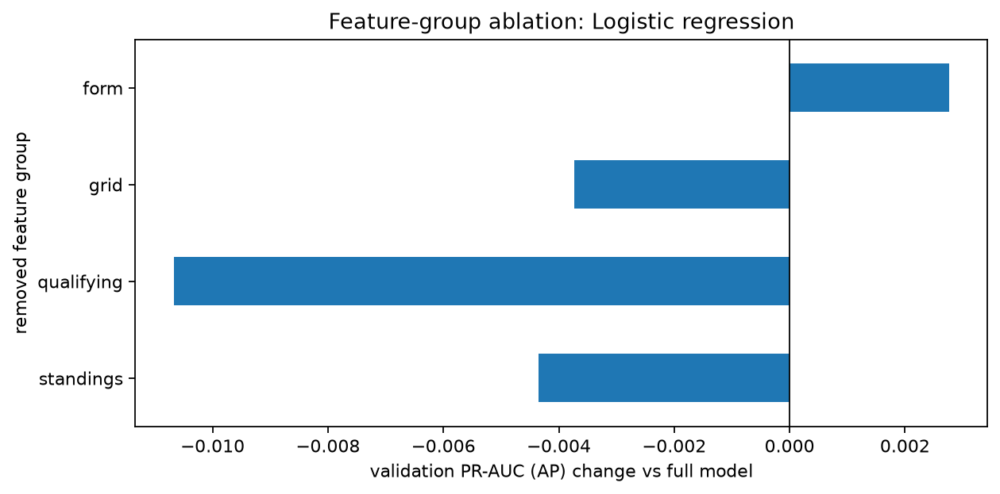

# Member 4 — Models and experiments

We compare logistic regression, random forest, and a shallow TensorFlow/Keras network on the same 15 pre-race features. Training uses seasons through 2019, validation uses 2020–2021, and test uses 2022–2024. All preprocessing is fitted on training rows only.

Actual split sizes: training 22459, validation 775, test 1352. Seed: 47.

Primary metric: PR-AUC (average precision), because podiums are the minority class. Secondary metric: F1 at a validation-selected threshold. ROC-AUC, precision, and recall are also reported. Average precision is not trapezoidal PR area.

## Modeling attempts and before/after results

Logistic regression supplies a linear baseline. A 200-tree forest learns interactions; the controlled experiment limits its depth to 8 and minimum leaf size to 5. The neural network uses 16 ReLU units and one sigmoid output, binary cross-entropy, Adam (0.001), batch size 128, and validation-loss early stopping with patience 5. Its selected epoch was 60.

| model | ROC-AUC | PR-AUC (AP) | F1 | precision | recall | F1 at 0.5 | threshold | settings | change vs logistic | train minus validation AP |
| --- | --- | --- | --- | --- | --- | --- | --- | --- | --- | --- |
| Logistic regression | 0.9282 | 0.7157 | 0.7116 | 0.6333 | 0.8120 | 0.6636 | 0.2462 | C=1; median imputation; standard scaling | 0.0000 | -0.1442 |
| Random forest | 0.9221 | 0.6441 | 0.6820 | 0.6181 | 0.7607 | 0.6538 | 0.2850 | 200 trees; unlimited depth; minimum leaf size 1 | -0.0716 | 0.3559 |
| Random forest (regularized) | 0.9319 | 0.7133 | 0.7054 | 0.6855 | 0.7265 | 0.6820 | 0.3750 | 200 trees; maximum depth 8; minimum leaf size 5 | -0.0024 | -0.0442 |
| Keras neural network | 0.9271 | 0.7020 | 0.7089 | 0.7000 | 0.7179 | 0.6476 | 0.3573 | 16 ReLU units; sigmoid; Adam 0.001; batch 128; early stopping (patience 5) | -0.0137 | -0.1166 |

The comparison shows observed validation differences; it does not establish statistical significance. The tuned validation F1 is optimistic because validation selected the threshold.

Each attempt includes validation prediction diagnostics at its validation-selected threshold. The confusion matrix shows raw counts; the probability histogram normalizes each actual class separately so the minority podium class remains visible. The dashed line marks the classification threshold. These validation plots are not held-out test estimates.

## Frozen selection and final performance

Validation selected **Logistic regression**, with threshold **0.2462**. Each threshold maximizes validation F1. Model selection uses validation AP, then F1 on exact ties, then the simpler model. Test results do not change this selection.

| model | split | ROC-AUC | PR-AUC (AP) | F1 | precision | recall | threshold |
| --- | --- | --- | --- | --- | --- | --- | --- |
| Logistic regression | train | 0.8988 | 0.5715 | 0.5839 | 0.4850 | 0.7334 | 0.2462 |
| Logistic regression | validation | 0.9282 | 0.7157 | 0.7116 | 0.6333 | 0.8120 | 0.2462 |
| Logistic regression | test | 0.9341 | 0.7115 | 0.6654 | 0.5306 | 0.8922 | 0.2462 |
| Random forest (regularized) | train | 0.9249 | 0.6691 | 0.6301 | 0.6109 | 0.6507 | 0.3750 |
| Random forest (regularized) | validation | 0.9319 | 0.7133 | 0.7054 | 0.6855 | 0.7265 | 0.3750 |
| Random forest (regularized) | test | 0.9404 | 0.7066 | 0.6667 | 0.6277 | 0.7108 | 0.3750 |
| Keras neural network | train | 0.9050 | 0.5854 | 0.5727 | 0.5509 | 0.5964 | 0.3573 |
| Keras neural network | validation | 0.9271 | 0.7020 | 0.7089 | 0.7000 | 0.7179 | 0.3573 |
| Keras neural network | test | 0.9333 | 0.7051 | 0.6697 | 0.6218 | 0.7255 | 0.3573 |

## Feature-group ablation

Each row removes one feature group and retrains with the frozen model settings and the same training/validation rows. Preprocessing is refitted on the reduced training features. For a winning network, its selected epoch count is fixed for every ablation.

| removed group | features | validation PR-AUC (AP) | change vs full |
| --- | --- | --- | --- |
| none (full model) | 15.0000 | 0.7157 | 0.0000 |
| standings | 11.0000 | 0.7113 | -0.0044 |
| qualifying | 11.0000 | 0.7050 | -0.0107 |
| grid | 12.0000 | 0.7119 | -0.0037 |
| form | 11.0000 | 0.7184 | 0.0028 |

The qualifying group contains grid-derived fallback information and grid_penalty. Removing the named grid columns therefore does not remove all grid information. Correlated groups may substitute for each other. These are model comparisons, not causal effects.

## Inference and XAI handoff

The complete and partially missing validation records both pass through the existing predict_podium function using the selected model. Missing qualifying uses the grid fallback; remaining missing values use training medians. The full comparison and XAI handoff objects are available in Section 4. Member 2 supplies the XAI figures and interpretations.

## Limitations

Historical qualifying missingness and era changes can affect generalization. Constructor renames reset history. We use one seed and one chronological validation window; observed differences are not uncertainty estimates. Earlier completed races supply rolling history for later validation/test races without refitting the model. The existing Section 3 inference demo inspected one test row, but test outcomes did not select our settings.
