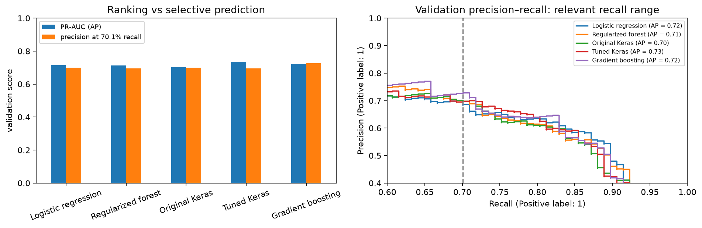
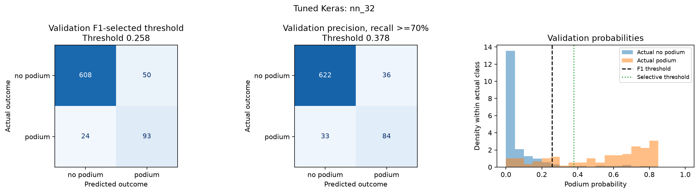
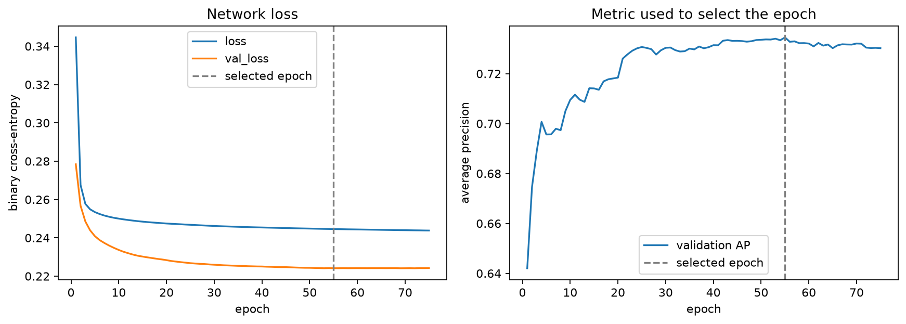
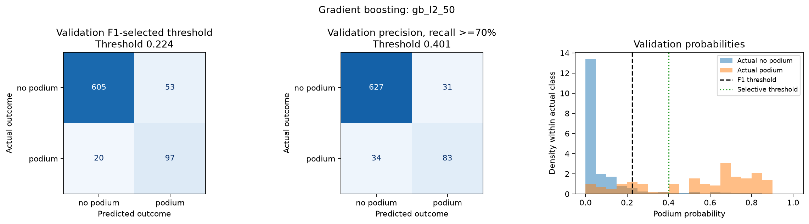
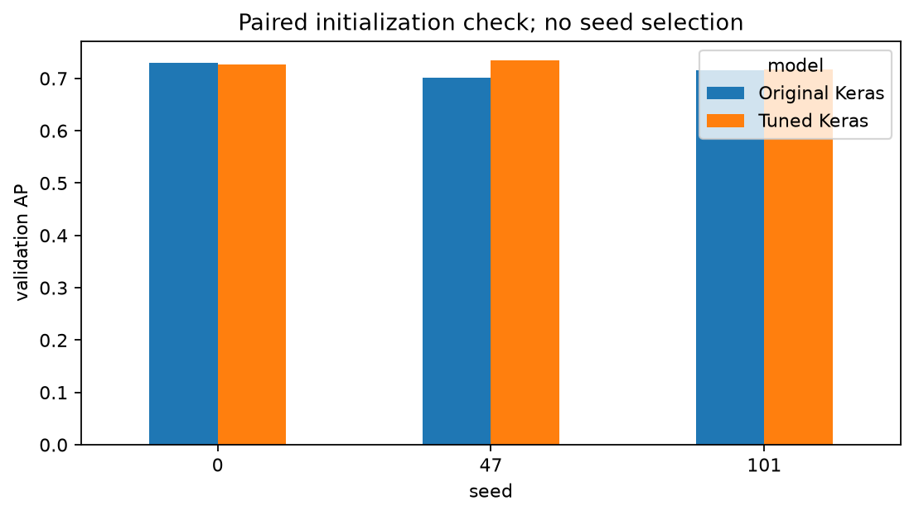
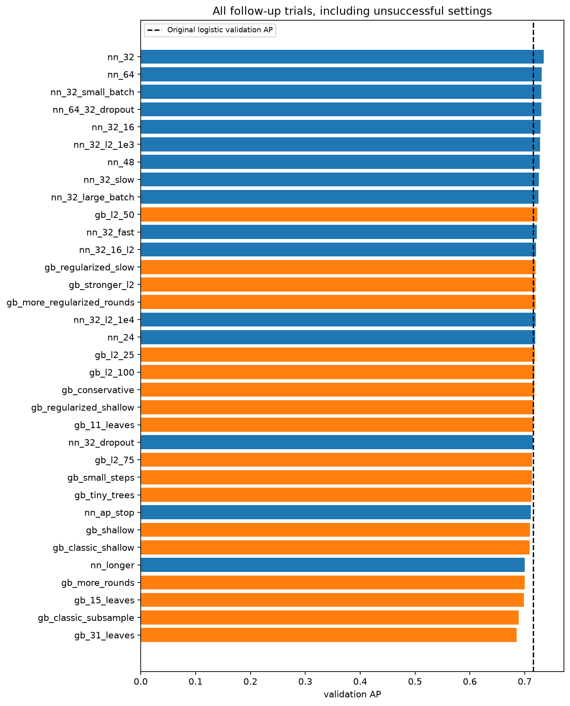

# Member 4 follow-up: validation-only tuning

The initial test figures had already been inspected before this follow-up was requested. All new tuning uses training and validation only; no new test predictions are generated. The initial benchmark and its final_model are preserved. These exploratory improvements need fresh held-out data for an independent generalization check.

We tried 16 neural configurations and 18 boosting configurations using all 15 original features and the same training/validation rows. Coarse changes were followed by nearby refinements; later neighbors did not improve the selected AP. This is a bounded local search, not proof of a global optimum. All successful and unsuccessful settings are recorded.

## Selected settings

| trial | family | settings | best epoch |
| --- | --- | --- | --- |
| nn_32 | neural network | {"batch_size": 128, "dropout": 0.0, "epochs": 240, "l2": 0.0, "learning_rate": 0.001, "monitor": "val_average_precision", "patience": 20, "random_state": 47, "units": [32]} | 55.0000 |
| gb_l2_50 | gradient boosting | {"l2_regularization": 50, "learning_rate": 0.05, "max_iter": 300, "max_leaf_nodes": 15} | nan |

## Validation comparison

| model | ROC-AUC | PR-AUC (AP) | F1 | precision | recall | false positives | threshold | precision at recall >=70% | recall at selective threshold | selective threshold | change vs original neural AP |
| --- | --- | --- | --- | --- | --- | --- | --- | --- | --- | --- | --- |
| Logistic regression | 0.9282 | 0.7157 | 0.7116 | 0.6333 | 0.8120 | 55.0000 | 0.2462 | 0.7009 | 0.7009 | 0.4261 | 0.0137 |
| Regularized forest | 0.9319 | 0.7133 | 0.7054 | 0.6855 | 0.7265 | 39.0000 | 0.3750 | 0.6975 | 0.7094 | 0.3974 | 0.0113 |
| Original Keras | 0.9271 | 0.7020 | 0.7089 | 0.7000 | 0.7179 | 36.0000 | 0.3573 | 0.7009 | 0.7009 | 0.3702 | 0.0000 |
| Tuned Keras | 0.9307 | 0.7345 | 0.7154 | 0.6503 | 0.7949 | 50.0000 | 0.2579 | 0.7000 | 0.7179 | 0.3783 | 0.0326 |
| Gradient boosting | 0.9316 | 0.7230 | 0.7266 | 0.6467 | 0.8291 | 53.0000 | 0.2239 | 0.7281 | 0.7094 | 0.4011 | 0.0210 |

## Precision at matched recall

| model | precision | recall | true positives | false positives | false negatives | threshold |
| --- | --- | --- | --- | --- | --- | --- |
| Logistic regression | 0.7009 | 0.7009 | 82.0000 | 35.0000 | 35.0000 | 0.4261 |
| Regularized forest | 0.6949 | 0.7009 | 82.0000 | 36.0000 | 35.0000 | 0.3980 |
| Original Keras | 0.7009 | 0.7009 | 82.0000 | 35.0000 | 35.0000 | 0.3702 |
| Tuned Keras | 0.6949 | 0.7009 | 82.0000 | 36.0000 | 35.0000 | 0.4008 |
| Gradient boosting | 0.7257 | 0.7009 | 82.0000 | 31.0000 | 35.0000 | 0.4047 |

All five models recover 82/117 validation podiums (70.09% recall), the smallest shared achievable recall at or above 70%. The highest precision at this point is **Gradient boosting**. PR-AUC remains primary.

The validation AP candidate is **Tuned Keras**. The best precision under the shared recall >=70% constraint is **Gradient boosting**. The precision constraint is a secondary comparison chosen to address false-positive concerns. Validation-selected thresholds and winning validation scores are optimistic after repeated selection.

## Paired seed check

| model | seed | PR-AUC (AP) | F1 |
| --- | --- | --- | --- |
| Original Keras | 0.0000 | 0.7297 | 0.6982 |
| Tuned Keras | 0.0000 | 0.7264 | 0.6979 |
| Original Keras | 47.0000 | 0.7020 | 0.7089 |
| Tuned Keras | 47.0000 | 0.7345 | 0.7154 |
| Original Keras | 101.0000 | 0.7153 | 0.7087 |
| Tuned Keras | 101.0000 | 0.7167 | 0.6979 |

| model | mean | std | min | max |
| --- | --- | --- | --- | --- |
| Original Keras | 0.7157 | 0.0139 | 0.7020 | 0.7297 |
| Tuned Keras | 0.7259 | 0.0089 | 0.7167 | 0.7345 |

Seed 47 remains fixed for the main comparison. Seeds 0 and 101 test sensitivity rather than select a luckier initialization. The tuned network does not have to win every pair; report the mean and spread. This does not quantify uncertainty over future races.

## Validation seasons

| model | year | validation AP |
| --- | --- | --- |
| Logistic regression | 2020.0000 | 0.6954 |
| Logistic regression | 2021.0000 | 0.7472 |
| Regularized forest | 2020.0000 | 0.6680 |
| Regularized forest | 2021.0000 | 0.7707 |
| Original Keras | 2020.0000 | 0.6635 |
| Original Keras | 2021.0000 | 0.7563 |
| Tuned Keras | 2020.0000 | 0.7122 |
| Tuned Keras | 2021.0000 | 0.7611 |
| Gradient boosting | 2020.0000 | 0.6732 |
| Gradient boosting | 2021.0000 | 0.7665 |

## All trials

| trial | family | PR-AUC (AP) | F1 | precision at recall >=70% | settings |
| --- | --- | --- | --- | --- | --- |
| nn_longer | neural network | 0.7001 | 0.7059 | 0.7069 | {"batch_size": 128, "dropout": 0.0, "epochs": 240, "l2": 0.0, "learning_rate": 0.001, "monitor": "val_loss", "patience": 20, "random_state": 47, "units": [16]} |
| nn_ap_stop | neural network | 0.7106 | 0.6991 | 0.6535 | {"batch_size": 128, "dropout": 0.0, "epochs": 240, "l2": 0.0, "learning_rate": 0.001, "monitor": "val_average_precision", "patience": 20, "random_state": 47, "units": [16]} |
| nn_32 | neural network | 0.7345 | 0.7154 | 0.7000 | {"batch_size": 128, "dropout": 0.0, "epochs": 240, "l2": 0.0, "learning_rate": 0.001, "monitor": "val_average_precision", "patience": 20, "random_state": 47, "units": [32]} |
| nn_64 | neural network | 0.7308 | 0.7132 | 0.7000 | {"batch_size": 128, "dropout": 0.0, "epochs": 240, "l2": 0.0, "learning_rate": 0.001, "monitor": "val_average_precision", "patience": 20, "random_state": 47, "units": [64]} |
| nn_32_16_l2 | neural network | 0.7202 | 0.7083 | 0.6949 | {"batch_size": 128, "dropout": 0.0, "epochs": 240, "l2": 0.0001, "learning_rate": 0.001, "monitor": "val_average_precision", "patience": 20, "random_state": 47, "units": [32, 16]} |
| nn_64_32_dropout | neural network | 0.7301 | 0.7007 | 0.6833 | {"batch_size": 128, "dropout": 0.1, "epochs": 240, "l2": 0.0001, "learning_rate": 0.001, "monitor": "val_average_precision", "patience": 20, "random_state": 47, "units": [64, 32]} |
| nn_32_l2_1e4 | neural network | 0.7195 | 0.7160 | 0.7000 | {"batch_size": 128, "dropout": 0.0, "epochs": 240, "l2": 0.0001, "learning_rate": 0.001, "monitor": "val_average_precision", "patience": 20, "random_state": 47, "units": [32]} |
| nn_32_l2_1e3 | neural network | 0.7277 | 0.7122 | 0.7009 | {"batch_size": 128, "dropout": 0.0, "epochs": 240, "l2": 0.001, "learning_rate": 0.001, "monitor": "val_average_precision", "patience": 20, "random_state": 47, "units": [32]} |
| nn_32_slow | neural network | 0.7261 | 0.7102 | 0.7130 | {"batch_size": 128, "dropout": 0.0, "epochs": 240, "l2": 0.0, "learning_rate": 0.0005, "monitor": "val_average_precision", "patience": 20, "random_state": 47, "units": [32]} |
| nn_32_fast | neural network | 0.7220 | 0.7126 | 0.7009 | {"batch_size": 128, "dropout": 0.0, "epochs": 240, "l2": 0.0, "learning_rate": 0.002, "monitor": "val_average_precision", "patience": 20, "random_state": 47, "units": [32]} |
| nn_32_small_batch | neural network | 0.7302 | 0.7131 | 0.7034 | {"batch_size": 64, "dropout": 0.0, "epochs": 240, "l2": 0.0, "learning_rate": 0.001, "monitor": "val_average_precision", "patience": 20, "random_state": 47, "units": [32]} |
| nn_32_16 | neural network | 0.7289 | 0.7029 | 0.6917 | {"batch_size": 128, "dropout": 0.0, "epochs": 240, "l2": 0.0, "learning_rate": 0.001, "monitor": "val_average_precision", "patience": 20, "random_state": 47, "units": [32, 16]} |
| nn_24 | neural network | 0.7191 | 0.7009 | 0.7009 | {"batch_size": 128, "dropout": 0.0, "epochs": 240, "l2": 0.0, "learning_rate": 0.001, "monitor": "val_average_precision", "patience": 20, "random_state": 47, "units": [24]} |
| nn_48 | neural network | 0.7270 | 0.7232 | 0.6949 | {"batch_size": 128, "dropout": 0.0, "epochs": 240, "l2": 0.0, "learning_rate": 0.001, "monitor": "val_average_precision", "patience": 20, "random_state": 47, "units": [48]} |
| nn_32_dropout | neural network | 0.7150 | 0.7039 | 0.7069 | {"batch_size": 128, "dropout": 0.05, "epochs": 240, "l2": 0.0, "learning_rate": 0.001, "monitor": "val_average_precision", "patience": 20, "random_state": 47, "units": [32]} |
| nn_32_large_batch | neural network | 0.7252 | 0.7049 | 0.7009 | {"batch_size": 256, "dropout": 0.0, "epochs": 240, "l2": 0.0, "learning_rate": 0.001, "monitor": "val_average_precision", "patience": 20, "random_state": 47, "units": [32]} |
| gb_shallow | gradient boosting | 0.7096 | 0.7004 | 0.6949 | {"l2_regularization": 1, "learning_rate": 0.1, "max_iter": 150, "max_leaf_nodes": 7} |
| gb_15_leaves | gradient boosting | 0.6981 | 0.7137 | 0.6748 | {"l2_regularization": 1, "learning_rate": 0.1, "max_iter": 150, "max_leaf_nodes": 15} |
| gb_more_rounds | gradient boosting | 0.6999 | 0.7099 | 0.6721 | {"l2_regularization": 1, "learning_rate": 0.05, "max_iter": 300, "max_leaf_nodes": 15} |
| gb_small_steps | gradient boosting | 0.7128 | 0.7082 | 0.6833 | {"l2_regularization": 1, "learning_rate": 0.03, "max_iter": 300, "max_leaf_nodes": 7} |
| gb_31_leaves | gradient boosting | 0.6852 | 0.6960 | 0.6667 | {"l2_regularization": 1, "learning_rate": 0.1, "max_iter": 150, "max_leaf_nodes": 31} |
| gb_stronger_l2 | gradient boosting | 0.7198 | 0.7104 | 0.6949 | {"l2_regularization": 10, "learning_rate": 0.05, "max_iter": 300, "max_leaf_nodes": 15} |
| gb_regularized_shallow | gradient boosting | 0.7168 | 0.7059 | 0.6942 | {"l2_regularization": 10, "learning_rate": 0.05, "max_iter": 400, "max_leaf_nodes": 7} |
| gb_regularized_slow | gradient boosting | 0.7200 | 0.7077 | 0.7009 | {"l2_regularization": 10, "learning_rate": 0.03, "max_iter": 400, "max_leaf_nodes": 15} |
| gb_l2_50 | gradient boosting | 0.7230 | 0.7266 | 0.7281 | {"l2_regularization": 50, "learning_rate": 0.05, "max_iter": 300, "max_leaf_nodes": 15} |
| gb_l2_100 | gradient boosting | 0.7180 | 0.7155 | 0.7217 | {"l2_regularization": 100, "learning_rate": 0.05, "max_iter": 300, "max_leaf_nodes": 15} |
| gb_conservative | gradient boosting | 0.7176 | 0.7138 | 0.7094 | {"l2_regularization": 50, "learning_rate": 0.05, "max_iter": 300, "max_leaf_nodes": 7} |
| gb_tiny_trees | gradient boosting | 0.7124 | 0.7043 | 0.7009 | {"l2_regularization": 10, "learning_rate": 0.05, "max_iter": 500, "max_leaf_nodes": 3} |
| gb_l2_25 | gradient boosting | 0.7186 | 0.7116 | 0.7130 | {"l2_regularization": 25, "learning_rate": 0.05, "max_iter": 300, "max_leaf_nodes": 15} |
| gb_l2_75 | gradient boosting | 0.7134 | 0.7148 | 0.7193 | {"l2_regularization": 75, "learning_rate": 0.05, "max_iter": 300, "max_leaf_nodes": 15} |
| gb_more_regularized_rounds | gradient boosting | 0.7195 | 0.7164 | 0.7034 | {"l2_regularization": 50, "learning_rate": 0.05, "max_iter": 500, "max_leaf_nodes": 15} |
| gb_11_leaves | gradient boosting | 0.7151 | 0.7119 | 0.7059 | {"l2_regularization": 50, "learning_rate": 0.05, "max_iter": 300, "max_leaf_nodes": 11} |
| gb_classic_shallow | gradient boosting | 0.7090 | 0.7043 | 0.7069 | {"implementation": "classic", "learning_rate": 0.05, "max_depth": 2, "min_samples_leaf": 20, "n_estimators": 200} |
| gb_classic_subsample | gradient boosting | 0.6890 | 0.7149 | 0.7193 | {"implementation": "classic", "learning_rate": 0.05, "max_depth": 3, "min_samples_leaf": 20, "n_estimators": 300, "subsample": 0.8} |

